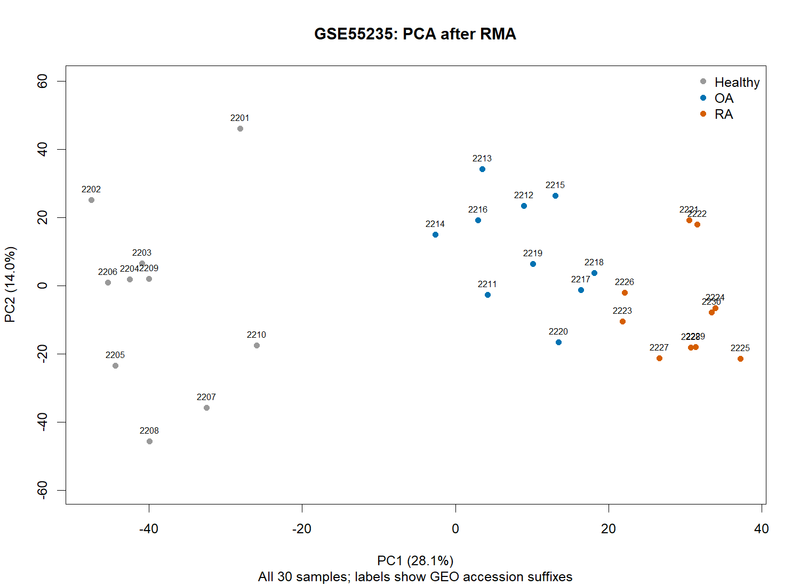
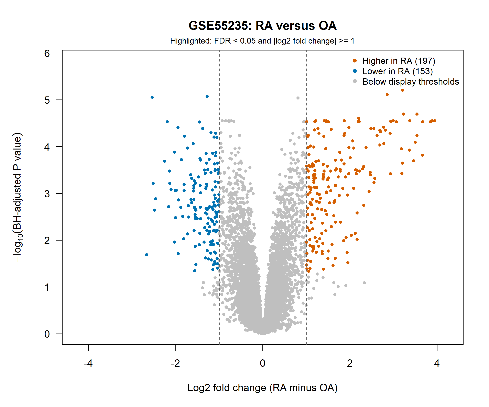
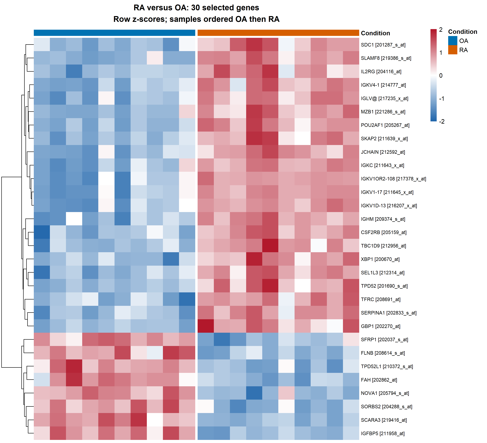
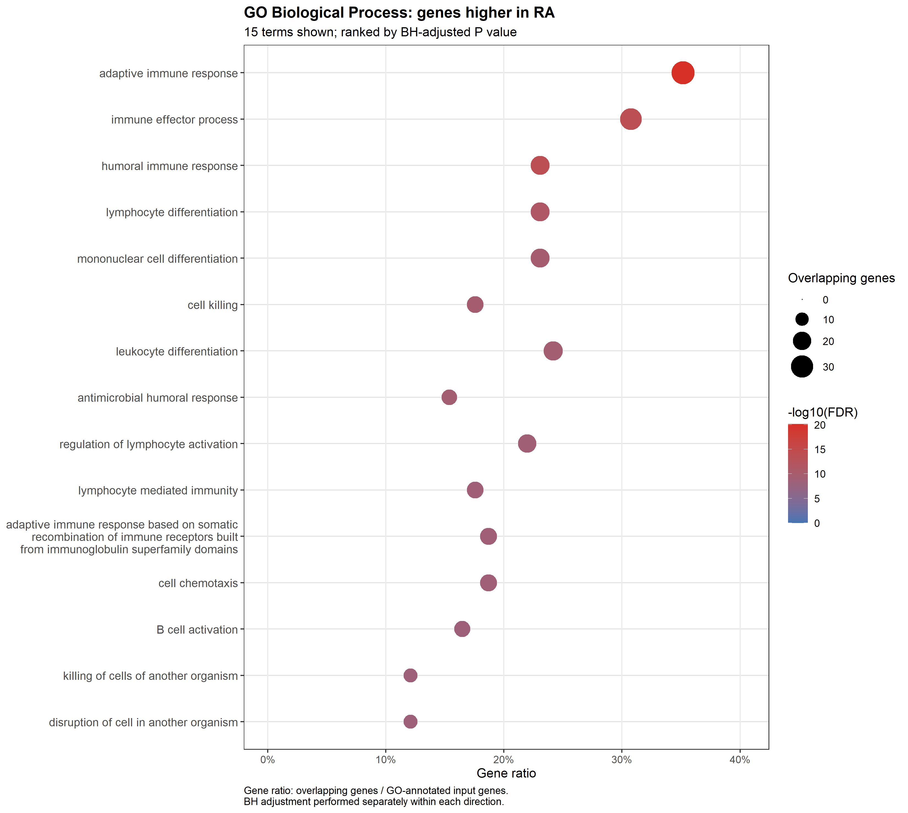
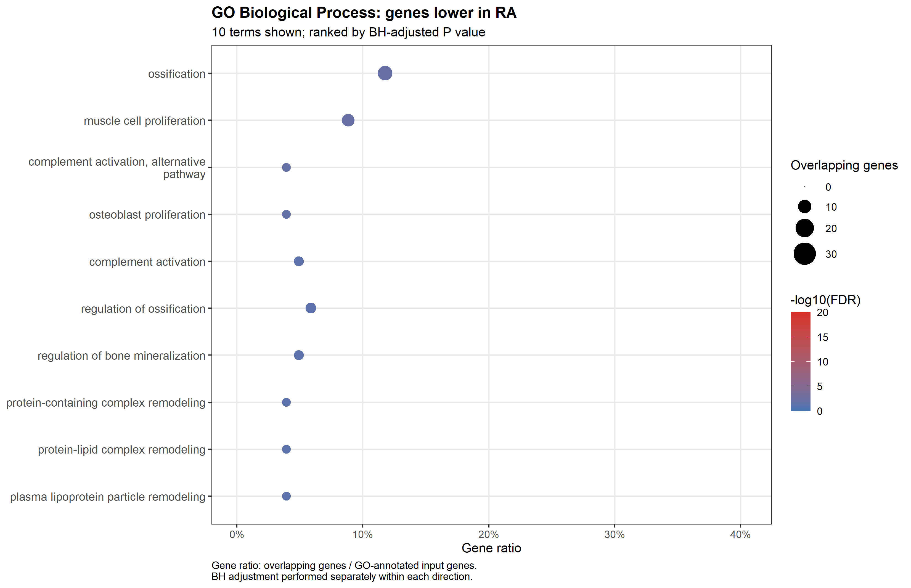
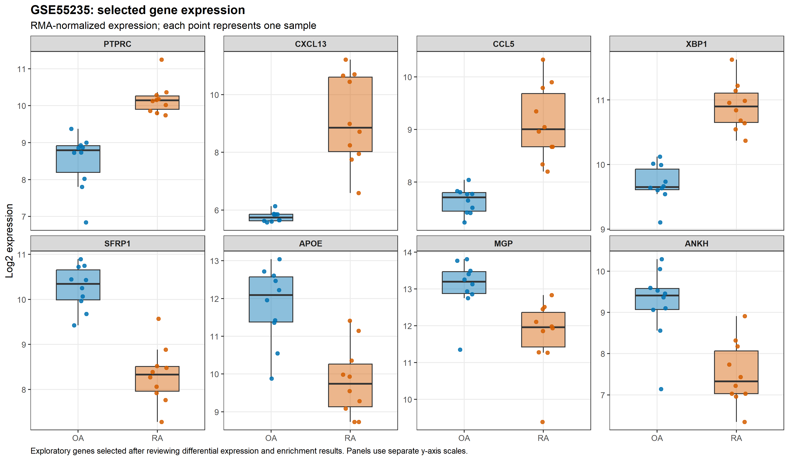

# RA versus OA synovial gene expression reanalysis

## Original study and project scope

This project is an exploratory reanalysis of GSE55235,
originally published by Woetzel et al. (2014).

The original study used MAS5 preprocessing and rule-based
classifiers across multiple centres. This project applies
RMA preprocessing, limma differential expression and GO
enrichment to the Berlin cohort.

Original publication:
Woetzel D, Huber R, Kupfer P, et al.
Identification of rheumatoid arthritis and osteoarthritis
patients by transcriptome-based rule set generation.
Arthritis Research & Therapy. 2014;16:R84.
https://doi.org/10.1186/ar4526

## Study and comparison

Dataset: GSE55235, platform GPL96 (Affymetrix HG-U133A). The dataset contains 10 Healthy, 10 OA, and 10 RA samples. The primary comparison uses the 10 RA and 10 OA samples as independent groups.

## Analysis methods

Expression was normalized using RMA. We used PCA for exploratory sample assessment. Limma fitted a group-only model with the RA-minus-OA contrast to RMA log2 expression. Positive log2 fold changes indicate higher expression in RA. We applied Benjamini-Hochberg adjustment across tested probes.

Probe annotations were obtained from hgu133a.db. The enrichment analysis retained probes mapping to one Entrez gene. One representative probe per gene was selected by highest average expression across the RA and OA samples, independently of statistical significance. Selection then required the original probe-level FDR < 0.05 and absolute log2 fold change >= 1.

GO Biological Process over-representation analysis was performed separately for genes higher and lower in RA. The background comprised all eligible representative-probe genes; only GO-annotated genes contribute to the enrichment calculation. Term sizes were restricted to 10-500 background genes. BH correction was applied separately within each direction.

## Differential expression summary

| Measure | Count |
| --- | --- |
| Probe sets tested | 22283 |
| Probe sets with FDR < 0.05 | 1922 |
| Probe sets with FDR < 0.05 and abs(log2FC) >= 1 | 350 |
| Selected probe sets higher in RA | 197 |
| Selected probe sets lower in RA | 153 |
| Background genes for enrichment | 12650 |
| Selected representative-probe genes for enrichment | 205 |

Probe counts and gene counts are distinct quantities.

## GO enrichment summary

| direction | input_genes | terms_tested | terms_FDR05 |
| --- | --- | --- | --- |
| higher_in_RA | 101 | 1583 | 276 |
| lower_in_RA | 104 | 2014 | 10 |

### Genes higher in RA: top 10 significant terms

| GO_ID | Biological_process | Gene_ratio | FDR | Genes |
| --- | --- | --- | --- | --- |
| GO:0002250 | adaptive immune response | 32/91 | 8.23e-21 | 32 |
| GO:0002252 | immune effector process | 28/91 | 1.50e-14 | 28 |
| GO:0006959 | humoral immune response | 21/91 | 1.92e-14 | 21 |
| GO:0030098 | lymphocyte differentiation | 21/91 | 4.53e-12 | 21 |
| GO:1903131 | mononuclear cell differentiation | 21/91 | 1.69e-10 | 21 |
| GO:0001906 | cell killing | 16/91 | 1.69e-10 | 16 |
| GO:0002521 | leukocyte differentiation | 22/91 | 4.23e-10 | 22 |
| GO:0019730 | antimicrobial humoral response | 14/91 | 4.23e-10 | 14 |
| GO:0051249 | regulation of lymphocyte activation | 20/91 | 1.23e-09 | 20 |
| GO:0002449 | lymphocyte mediated immunity | 16/91 | 1.58e-09 | 16 |

### Genes lower in RA: top 10 significant terms

| GO_ID | Biological_process | Gene_ratio | FDR | Genes |
| --- | --- | --- | --- | --- |
| GO:0001503 | ossification | 12/102 | 7.75e-03 | 12 |
| GO:0033002 | muscle cell proliferation | 9/102 | 7.75e-03 | 9 |
| GO:0006957 | complement activation, alternative pathway | 4/102 | 1.03e-02 | 4 |
| GO:0033687 | osteoblast proliferation | 4/102 | 1.20e-02 | 4 |
| GO:0006956 | complement activation | 5/102 | 3.17e-02 | 5 |
| GO:0030278 | regulation of ossification | 6/102 | 3.91e-02 | 6 |
| GO:0030500 | regulation of bone mineralization | 5/102 | 4.21e-02 | 5 |
| GO:0034367 | protein-containing complex remodeling | 4/102 | 4.70e-02 | 4 |
| GO:0034368 | protein-lipid complex remodeling | 4/102 | 4.70e-02 | 4 |
| GO:0034369 | plasma lipoprotein particle remodeling | 4/102 | 4.70e-02 | 4 |

GO terms overlap and must not be interpreted as independent findings. Enrichment indicates over-representation of annotated genes; it does not establish activation or inhibition of a process.

## Selected-gene sensitivity analysis

Eight genes were selected after reviewing the analysis. Limma was refitted 20 times, omitting one sample per refit. BH adjustment was recalculated across all probes in each refit. Original RMA normalization was held fixed.

| Gene | Full_log2FC | Minimum_LOO_log2FC | Maximum_LOO_log2FC | Same_direction_all_runs | Runs_passing_both_thresholds |
| --- | --- | --- | --- | --- | --- |
| PTPRC | 1.664 | 1.479 | 1.76 | TRUE | 20/20 |
| CXCL13 | 3.358 | 3.127 | 3.64 | TRUE | 20/20 |
| CCL5 | 1.478 | 1.344 | 1.58 | TRUE | 20/20 |
| XBP1 | 1.194 | 1.114 | 1.253 | TRUE | 20/20 |
| SFRP1 | -1.947 | -2.086 | -1.832 | TRUE | 20/20 |
| APOE | -2.003 | -2.219 | -1.868 | TRUE | 20/20 |
| MGP | -1.315 | -1.506 | -1.051 | TRUE | 20/20 |
| ANKH | -1.699 | -1.929 | -1.569 | TRUE | 20/20 |

These overlapping refits provide internal sensitivity assessment, not independent validation.

## Figures

### PCA

### Volcano plot

### Selected-gene heatmap

### GO terms: genes higher in RA

### GO terms: genes lower in RA

### Individual-sample gene expression

## Interpretation limits

- This is an exploratory analysis of one dataset.
- The fitted model includes disease group only; potential covariate confounding remains.
- Bulk expression cannot by itself distinguish changes in cell composition from changes within cells.
- Gene and heatmap selections used the same samples being displayed.
- Probe mapping and representative-probe selection affect the enrichment inputs.
- Leave-one-out sensitivity was assessed for eight selected genes, not the full result set.
- No independent cohort or experimental validation was performed.

## Reproducibility

Numbered scripts are stored in scripts/. Results, figures, annotation mappings and session information are saved in the project directories. See results/enrichment/selection_rules.txt for gene-selection rules.
